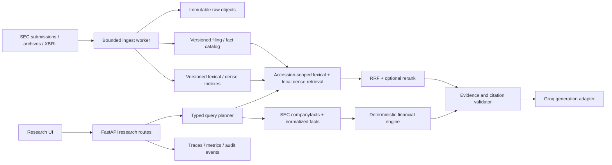

# SEC Insight AI — evidence-based engineering plan for Phases 3–5

**Decision date:** 2026-10-27 (America/New_York)
**Repository reviewed:** [`Bijay-Thakur/rag-sec-10k`](https://github.com/Bijay-Thakur/rag-sec-10k), `main` at [`d71a25d`](https://github.com/Bijay-Thakur/rag-sec-10k/commit/d71a25d6e52146e598ce8e27df122ecf715540c6).
**Scope:** Research retrieval, XBRL-backed financial reasoning, evaluation, observability and user experience. Preserve existing auth/Supabase behavior; no auth redesign.
**Status vocabulary:** *Observed* means checked in source or a read-only response; *reported* means a repository report or PR says it happened; *unknown* means evidence is insufficient. A passing test is not proof of live operation.

## 1. Evidence ledger and Phase 0–2 verdict

| Area | Evidence at this review | Verdict / implication |
|---|---|---|
| GitHub merge state | [PR #1](https://github.com/Bijay-Thakur/rag-sec-10k/pull/1) merged as `afc0517`; [PR #2](https://github.com/Bijay-Thakur/rag-sec-10k/pull/2) merged as `d71a25d`, which is current `main`. The tree at that commit also contains `backend/app/research/*`, `compose.research.yml` and the [Phase 2 report](https://github.com/Bijay-Thakur/rag-sec-10k/blob/d71a25d6e52146e598ce8e27df122ecf715540c6/docs/phase-reports/phase-2.md). | Phase 0–2 code is present on `main`; merging does not establish the release gates below. |
| Phase 0 vector safety | [Baseline audit](https://github.com/Bijay-Thakur/rag-sec-10k/blob/d71a25d6e52146e598ce8e27df122ecf715540c6/docs/audits/financial_research_baseline.md) reports 58 offline tests, rejection of a zero-vector fixture, no verified real index, and no live semantic/citation check. Current [adapter](https://github.com/Bijay-Thakur/rag-sec-10k/blob/d71a25d6e52146e598ce8e27df122ecf715540c6/backend/app/adapters/rag_adapter.py#L166-L191) checks the legacy collection before semantic retrieval. | Code safety repair exists; end-to-end semantic quality and index provenance remain unproven. |
| Phase 1 SEC discovery | [SEC adapter](https://github.com/Bijay-Thakur/rag-sec-10k/blob/d71a25d6e52146e598ce8e27df122ecf715540c6/backend/app/research/sec_client.py) and [read-only routes](https://github.com/Bijay-Thakur/rag-sec-10k/blob/d71a25d6e52146e598ce8e27df122ecf715540c6/backend/app/research/api.py) are implemented. The [Phase 1 report](https://github.com/Bijay-Thakur/rag-sec-10k/blob/d71a25d6e52146e598ce8e27df122ecf715540c6/docs/phase-reports/phase-1.md) reports 76 offline tests and explicitly blocks its live SEC smoke pending a real contact and confirmed instance/rate policy. | Discovery is implemented, but live SEC behavior is unverified. |
| Phase 2 ingestion | [Worker](https://github.com/Bijay-Thakur/rag-sec-10k/blob/d71a25d6e52146e598ce8e27df122ecf715540c6/backend/app/research/worker.py), [versioned local store](https://github.com/Bijay-Thakur/rag-sec-10k/blob/d71a25d6e52146e598ce8e27df122ecf715540c6/backend/app/research/storage.py) and [operator-gated API](https://github.com/Bijay-Thakur/rag-sec-10k/blob/d71a25d6e52146e598ce8e27df122ecf715540c6/backend/app/research/ingestion_api.py) exist. Default embedding is a **token-hash lexical diagnostic**; real embedding is opt-in. `READY_LOCAL` is the publication state. [Phase 2 report](https://github.com/Bijay-Thakur/rag-sec-10k/blob/d71a25d6e52146e598ce8e27df122ecf715540c6/docs/phase-reports/phase-2.md) says live SEC, real embeddings, replacement/restart and production storage were not tested. | Local ingestion slice exists; no dynamic research Q&A or production-ready index. |
| Current production frontend | Vercel project `prj_9TvilHCfcWpAdaLooLAfLvucYdgP` returned a `READY` production deployment of `d71a25d` with alias [`rag-sec-10k-alpha.vercel.app`](https://rag-sec-10k-alpha.vercel.app/). A read-only fetch of `/` returned HTTP 200; prerendered HTML displayed “API offline.” | Frontend deploy/build and HTTP availability observed. Prerendered status alone cannot establish hydrated browser behavior. |
| Current production backend via frontend proxy | Read-only fetches of [`/api-proxy/health`](https://rag-sec-10k-alpha.vercel.app/api-proxy/health) and [`/api-proxy/api/filings`](https://rag-sec-10k-alpha.vercel.app/api-proxy/api/filings) returned HTTP 200 at approximately 00:57 EDT on 2026-10-27. Health JSON said `status=ok`, `index_ready=true`, version `1.0.0`; catalog listed five legacy filings. The [health implementation](https://github.com/Bijay-Thakur/rag-sec-10k/blob/d71a25d6e52146e598ce8e27df122ecf715540c6/backend/app/main.py#L192-L204) tests the default **legacy** index. | A backend answered those two routes. Its deployed revision, image digest, storage mount, vector provenance, answer quality, new SEC routes, and worker state were **not** established. `index_ready=true` is not a dynamic research readiness verdict. |
| CI and local runtime | [CI workflow](https://github.com/Bijay-Thakur/rag-sec-10k/blob/d71a25d6e52146e598ce8e27df122ecf715540c6/.github/workflows/ci.yml) runs a subset of backend tests plus frontend lint/build; it omits `test_sec_discovery.py` and `test_research_ingestion.py`. GitHub’s commit-workflow lookup returned no runs for `d71a25d` during this review. Docker was not run here. | Expand CI before claiming a protected regression gate. PR-reported tests are not independently rerun in this review. |

The older [V2 upgrade plan](https://github.com/Bijay-Thakur/rag-sec-10k/blob/d71a25d6e52146e598ce8e27df122ecf715540c6/V2_UPGRADE_PLAN.md) is a June audit and useful design history, but its “no API/Docker/CI/EDGAR” statements are stale. Its Apple-only retrieval and RAGAS numbers are historical offline measurements. Reuse its aspiration—multi-filing, cited research with measured quality—while taking current source and phase reports as the implementation baseline. The prior conversation likewise calls for a Financial Research System and evidence-led RAG work; it is a goal, not evidence that phases shipped.

### Immediate gate before enabling dynamic research

1. Record exact deployed frontend commit and backend image digest/revision, env **names** (not values), instance count, mounted index/storage and rollback target. Reconcile the observed `index_ready=true` against the Phase 0 audit; do not infer real index provenance from health alone.
2. With an authentic organization/contact `SEC_USER_AGENT` and verified aggregate limiter, run a **bounded, opt-in** discovery smoke over three issuers and one older submissions page. Capture CIK, accession, source URL, response status and timestamp. SEC says scripted requests should identify the caller and currently stay under 10 requests/s; use this app’s more conservative 2/s budget across all workers. [SEC fair access](https://www.sec.gov/search-filings/edgar-search-assistance/accessing-edgar-data), [SEC API documentation](https://www.sec.gov/search-filings/edgar-application-programming-interfaces).
3. In staging, ingest two previously unseen issuers including a 10-Q and one amendment. Verify raw SHA-256, exact accession/period links, table/footnote extraction quality, queue recovery after container replacement and no cross-accession hits. Keep the old five-filing path intact until this succeeds.
4. Freeze a real, provenance-verified embedding baseline. The user selected **Groq for generation and local embeddings for dense retrieval**. Groq’s published [API reference](https://console.groq.com/docs/api-reference) and [models documentation](https://console.groq.com/docs/models) inspected on this date show generation/model APIs but no documented text embedding endpoint; do not point the OpenAI embedding client at Groq and assume it works. Use a named, versioned local embedding model, measured in staging, with recorded dimensions, normalization and build SHA. Recheck Groq documentation at implementation time; changing embedding provider requires a new index revision and evaluation.

## 2. Target architecture and contracts

**Identity:** CIK + accession are mandatory; form, filed date, report period, amendment status, original URL, raw checksum, parser/chunker/embedding revision and publication time travel with each chunk and fact. A query chooses an explicit set of accession revisions. No default retrieval across all issuers. Evidence IDs must resolve to the exact source span or fact record used in the answer.

**Interfaces:** Keep SEC transport, immutable object store, metadata/jobs, lexical index, dense index, reranker, generation and telemetry behind narrow adapters. Implement query planning as typed intents (`narrative`, `single_fact`, `calculation`, `comparison`, `unsupported`) with deterministic routing and an explicit refusal state. Groq is the generation adapter; the API key comes only from `GROQ_API_KEY` in an untracked local `.env` or approved server secret at deployment time. A local embedding model does not use this key. Never log key, prompts containing secrets, raw authentication headers or full filing text.

**Publication pattern:** Ingest into a new immutable revision; validate extraction, vectors and citation targets; then atomically switch the `ready_revision` pointer. Reads pin a revision for their full request. Retain the prior revision for rollback. Avoid a destructive in-place reindex. A production metadata/object/index stack must be chosen by a documented ADR after measuring current SQLite limits and operational requirements; the existing local SQLite + volume is a development baseline, not a cloud durability claim.

## 3. Phase 3 — accession-scoped advanced hybrid retrieval

**Outcome:** A user can select a discovered, *validated and ready* 10-K/10-Q and ask a question with cited passages from that exact filing. Discovery alone never makes a filing answerable.

**Build sequence**

1. Add explicit publication states: discovered → queued/processing → `READY_LOCAL` diagnostic or `READY_RESEARCH` after real local embeddings and validation. Store embedding model/version/dimension, vector build checksum and retrieval index revision. Never map local hash vectors to semantic readiness.
2. Build one versioned lexical index and one local dense index from identical chunk IDs. Preserve Part/Item and repeated Item occurrence; improve table/footnote attribution before allowing numerical table chunks. Enforce CIK, accession, revision and optional Item filters **inside** both stores, then assert them again after fusion. Reject mixed scopes. Expose bounded top-k/pool sizes and stable ranking scores.
3. Compare BM25-only, dense-only, reciprocal-rank fusion and fusion plus optional reranker on a frozen multi-issuer, multi-form set. Start with simple RRF as the reference implementation. Enable reranking only if measured relevance gain exceeds latency/cost tradeoff; no assumed improvement from the older Apple numbers.
4. Add a dynamic research answer route separate from legacy `/api/ask`: typed request, explicit filing scope, evidence IDs, answerability state, citations, model/index revision, usage and trace ID. Use Groq only after retrieval. Validate every generated citation against supplied evidence; unsupported numbers or cross-filing claims produce partial/refusal output. Treat retrieved filing text as untrusted data and test instruction injection.
5. Update the Explorer to show discovered/processing/ready/failed accurately and let the user inspect evidence before asking. Keep the legacy five-filing flow available behind its existing route until parity and rollback are demonstrated.

**Stage gate 3:** Full offline tests and CI pass; staging ingestion and replacement tests pass; zero scope leaks and zero fabricated citation links on adversarial fixtures; a documented, accession-labeled retrieval baseline is published with Recall@k, MRR/nDCG, citation hit rate, abstention and p50/p95 latency by query class. Candidate must be no worse than the frozen local baseline on predeclared primary metrics, and all critical isolation/citation checks must pass. A live research enablement decision remains separate and requires deployment approval.

**Rollback:** Disable the dynamic route/feature flag, repoint to prior ready index revision, keep raw objects and failed revision for analysis, and leave legacy `/api/ask` untouched. Do not overwrite old vectors or change existing five-filing IDs.

## 4. Phase 4 — XBRL-backed financial reasoning

**Outcome:** Financial values and calculations come from typed SEC facts or explicitly attributed filing table cells, never free-form LLM arithmetic. Groq may explain the calculation but cannot invent operands.

**Build sequence**

1. Add a server-only SEC XBRL adapter for `companyfacts` and, when needed, `companyconcept`; retain raw response checksum and fetch time. SEC describes these APIs, their non-custom taxonomy/entity-wide coverage, units and period frames in its [EDGAR API documentation](https://www.sec.gov/search-filings/edgar-application-programming-interfaces). This coverage limit means a missing fact is not necessarily a missing disclosure; fall back to attributed filing text/table extraction or return “unavailable.”
2. Normalize each fact with CIK, accession, taxonomy/concept, unit, value, start/end, fiscal year/period, form, filed date, frame if supplied, and raw source record. Link facts to the selected filing revision; handle amendments, restatements and multiple filings reporting the same period with an explicit as-filed/as-of selection rule. Preserve fiscal versus calendar periods and instant versus duration concepts.
3. Implement reviewed formulas (`YoY`, margin, ratio, CAGR only when valid) using decimal arithmetic and unit/period checks. Expose operand IDs, formula, result, rounding rule and warnings. Refuse division by zero, incomparable units, mixed duration lengths, missing operands and ambiguous concept mappings. Multi-company comparison must show source basis and comparability caveats.
4. Route factual and calculation intents to the fact engine first; attach narrative retrieval only for context. Groq writes an explanation from validated operands and citations. The response schema distinguishes reported values, calculated values and narrative claims.
5. Evaluate with accession-labeled gold facts across at least 10-K and 10-Q, amended/restated examples, fiscal-calendar mismatch, unit changes, custom-taxonomy gaps, table footnotes and negative tests. Record exact-match/within-tolerance numeric accuracy, operand/citation correctness and refusal precision.

**Stage gate 4:** No ungrounded numeric output in the frozen financial suite; every supported value resolves to a fact or verified cell and exact filing/period; all unit/period/amendment negative tests refuse or warn correctly. Promote only formulas and concepts that meet predeclared thresholds derived from a measured baseline; document unsupported cases rather than guessing.

**Rollback:** Flag off XBRL reasoning and keep Phase 3 narrative retrieval. Facts are append-only/versioned; revert the active fact-map revision, not raw SEC source records.

## 5. Phase 5 — evaluation, observability and product refinement

**Outcome:** The research flow is measurable, operable and honest about coverage and freshness.

**Build sequence**

1. Create a versioned evaluation corpus across issuers, 10-K/10-Q, periods, amendments and question types, with adjudicated source spans/facts and explicit unanswerable cases. Separate development/tuning and held-out test sets. Keep the historical Apple 50 questions as a regression slice only; never market its old RAGAS/Recall values as new production quality.
2. Run deterministic retrieval/numeric/citation checks on each PR. Run controlled Groq generation evaluations in staging with fixed prompts/model IDs, bounded budgets and human review for faithfulness. Report slice-level scores, confidence intervals when sample size supports them, regressions, cost and latency; do not collapse failure classes into one overall score.
3. Instrument request/ingest trace IDs, scope and revision, SEC status/retries, parsing warnings, chunk count, index age, retrieval path/ranks, citation validation, abstention, Groq model/tokens/latency/cost, errors and worker lease state. Redact secrets and sensitive user text by default; define retention and sampling. Alert on stale ingestion, source failure, abnormal cost, failed jobs, citation failures and cross-scope assertions.
4. Refine the UI around issuer → filing → verified ready state → research answer → inspect source/facts. Display filing date, report period, amendment, source link, model/index revision and limitations. Make “historical offline benchmark” visually distinct from current run metrics. Verify accessibility, empty/error states and mobile layout.
5. Create an operator runbook for SEC access, index rebuild, worker recovery, secret rotation, rollback and incident investigation. Test backup/restore and a staged rollback drill. Record backend deployment provenance separately from Vercel frontend status.

**Stage gate 5:** CI covers the new code and security tests; staging end-to-end flow and backup/restore/rollback drills pass; telemetry explains a sampled answer end to end; user-facing labels match actual readiness. A release candidate includes frozen benchmark report, known limitations, cost budget and operator sign-off. No production deployment occurs without explicit authorization.

## 6. Cross-phase security, tests and release controls

- Keep `GROQ_API_KEY` only in an ignored `.env` for local work; use a deployment secret manager if production is later approved. Never put it in `NEXT_PUBLIC_*`, Markdown, commits, screenshots, logs or browser bundles. The key supplied in chat should be rotated before any production use because it has already been shared in a conversation. Verify `.gitignore` and `git ls-files` before every commit.
- SEC fetches must use allowlisted HTTPS hosts/paths, no redirects, bounded decoded bytes/timeouts/retries, authentic contact and one aggregate throttle across processes. Use fixtures in CI. [SEC fair access](https://www.sec.gov/search-filings/edgar-search-assistance/accessing-edgar-data).
- Treat filing text and Groq output as untrusted: no tool execution from document instructions; validate generated citations and typed outputs server-side. Enforce query scope in storage and post-retrieval, and limit input/context/output, concurrency and spend.
- Required test layers: schema/contract, parser and table attribution, synthetic SEC transport, idempotent/restartable jobs, cross-accession isolation, vector provenance, retrieval ranking, citation verifier, numeric engine, prompt-injection/refusal, UI states, and staging end-to-end/rollback. Expand `.github/workflows/ci.yml` to include Phase 1–5 tests.
- Every stage produces an evidence report: pinned commit, exact commands/results, fixture versus live distinction, sample sizes, benchmark data version, deployment/revision IDs where applicable, unresolved risks and GO/NO-GO. A blocked live gate does not prevent local implementation, but it prevents a live-readiness claim.

## 7. First next steps

1. Reconcile actual Cloud Run/backend revision and vector provenance with the Vercel `d71a25d` frontend and observed health response.
2. Add missing Phase 1/2 tests to CI, then complete authentic SEC smoke and staging ingestion/restart checks.
3. Pin and benchmark a local embedding model, establish a versioned accession-labeled gold set, and implement Phase 3 behind a disabled feature flag.
4. Build Phase 4 facts/calculations and Phase 5 evaluation/telemetry only against the validated revision contracts above.

**Official external references:** [SEC EDGAR APIs](https://www.sec.gov/search-filings/edgar-application-programming-interfaces); [SEC accessing EDGAR / fair access](https://www.sec.gov/search-filings/edgar-search-assistance/accessing-edgar-data); [SEC developer FAQ](https://www.sec.gov/about/webmaster-frequently-asked-questions); [Groq API reference](https://console.groq.com/docs/api-reference); [Groq OpenAI compatibility](https://console.groq.com/docs/openai); [Groq model list](https://console.groq.com/docs/models).
